# ESO prijungimo sąlygos — agent demo

[](https://github.com/VentureJuozas/ESO-automation/actions/workflows/ci.yml)

An AI **orchestrator** (LangGraph) prepares 0.4 kV grid-connection technical conditions for a household on substation **12-608**. Deterministic Python decides. The LLM only parses text and may phrase TS §3. An engineer always approves.

The dashboard is an **n8n-style canvas**. The default screen is a **manager queue desk**. A **customer mock** (no ESO branding) sits beside it. Five **adapters** (GIS, Power BI, CRM, pricing, TS registry) are mocks today and stubs for production.

## Quickstart (fresh clone)

Python 3.11+ and Node 20+. No API key.

```bash
make demo
```

Open http://127.0.0.1:8000 — or `bash scripts/demo.sh` / `docker compose up --build`.

```bash
make test
```

Queue, runs and audit persist in `data/demo.sqlite`. **Atstatyti demo** reseeds.

Jury walkthrough: [docs/DEMO_SCRIPT.md](docs/DEMO_SCRIPT.md) · A4 leave-behind: `/api/onepager.html` · rounds: [CHANGELOG.md](CHANGELOG.md)

`make demo` installs Python deps and **builds `web/dist` if it is missing**, then serves on :8000.

## Screenshots

Final 1920×1080 set (also under `/opt/cursor/artifacts/`). Slide numbers: [docs/PITCH_FACTS.md](docs/PITCH_FACTS.md).

| View | File |
|---|---|
| Split — customer and desk | 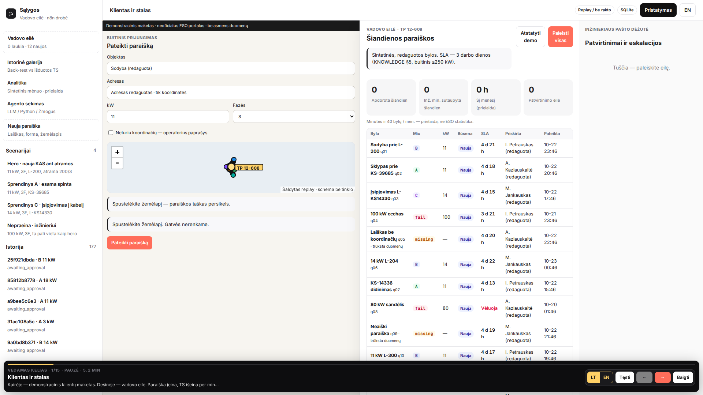 |
| Desk queue | 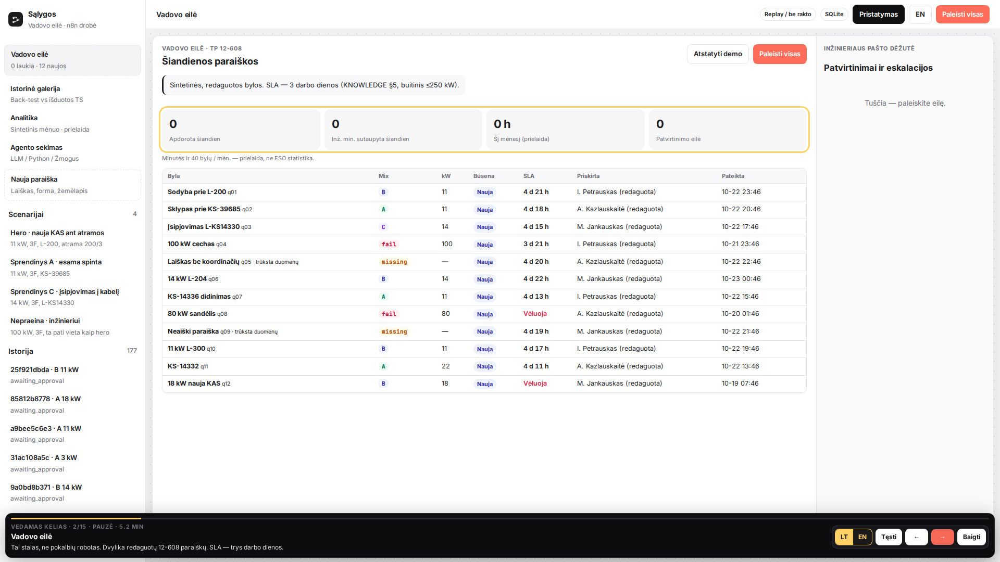 |
| Queue after **Paleisti visas** | 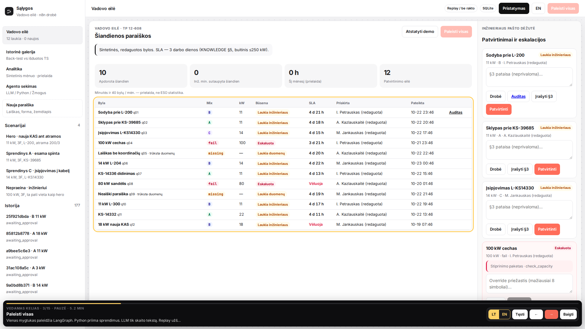 |
| Hero canvas + inspector | 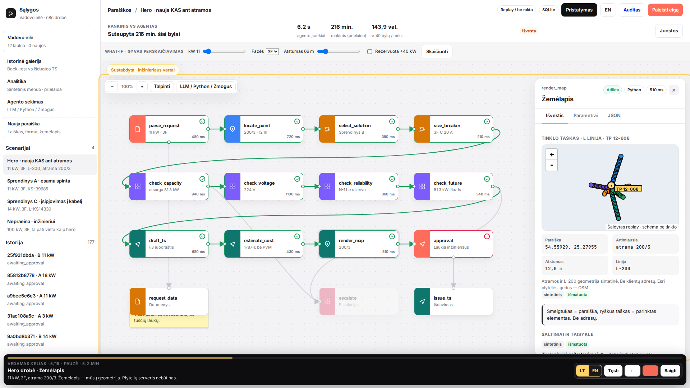 |
| A / B / C comparison | 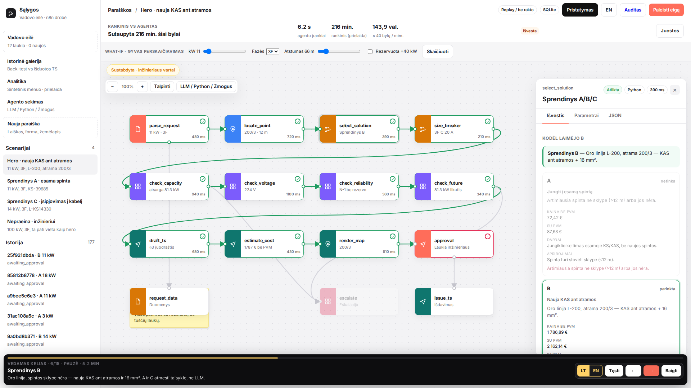 |
| Capacity 227.7 + 11 = 238.7 / 320 | 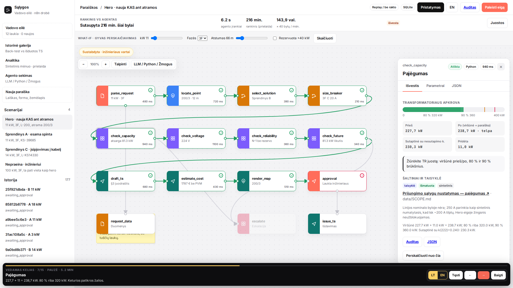 |
| Voltage profile | 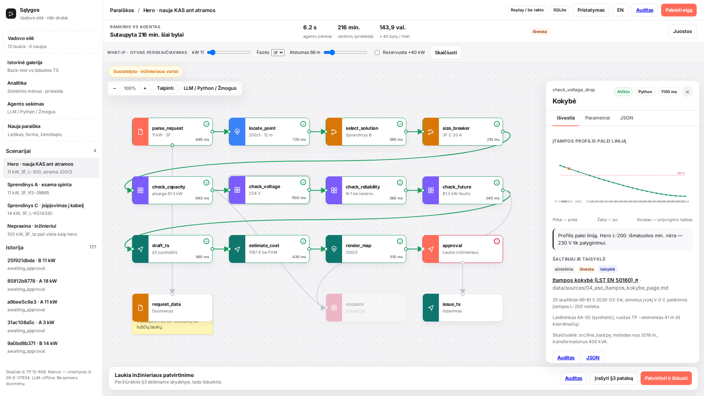 |
| TS page 1 | 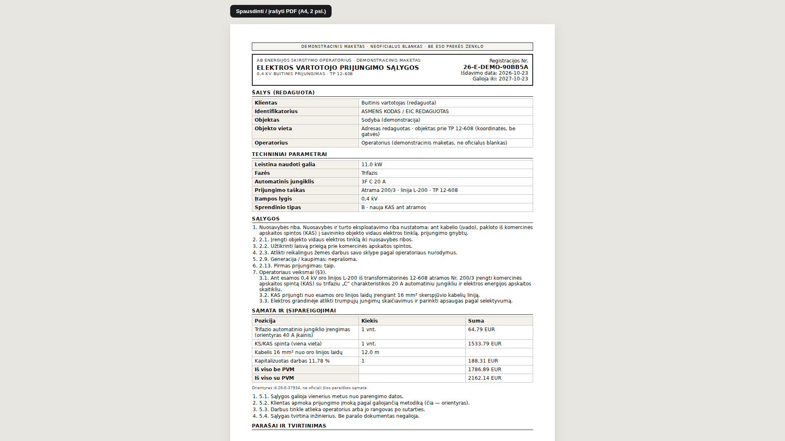 |
| TS page 2 — GIS annex | 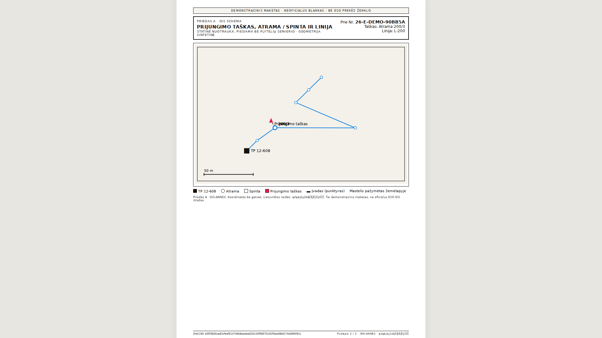 |
| Fail reinforcement brief | 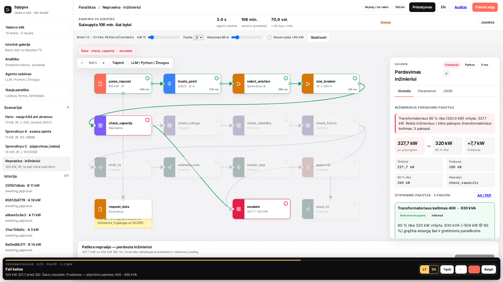 |
| Gallery taxonomy | 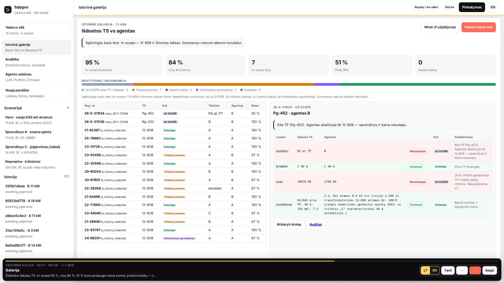 |
| What-if 100 kW | 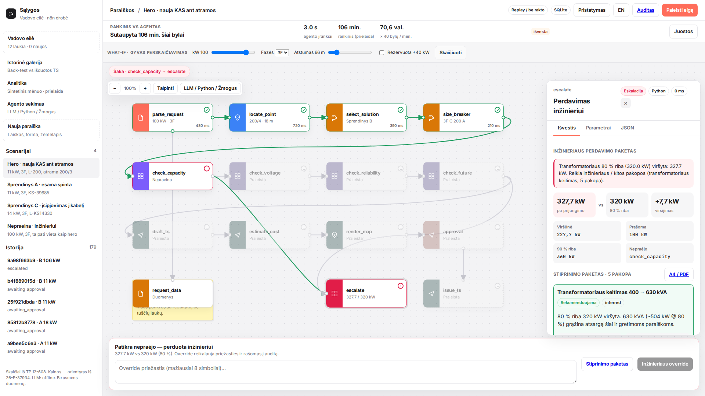 |
| Agento sekimas | 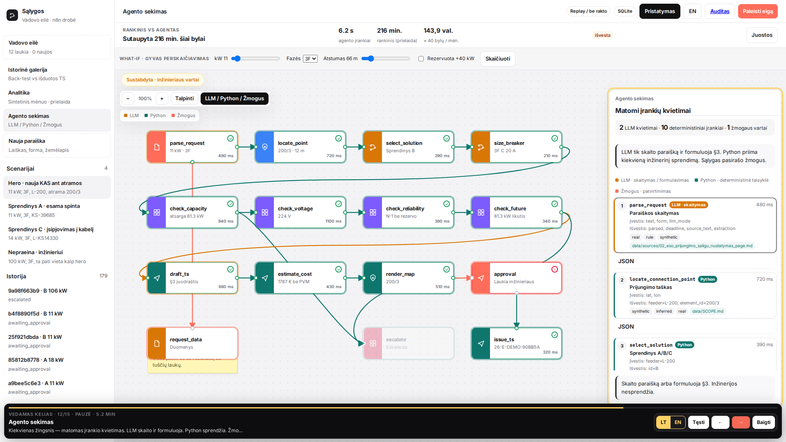 |
| Integracijos | 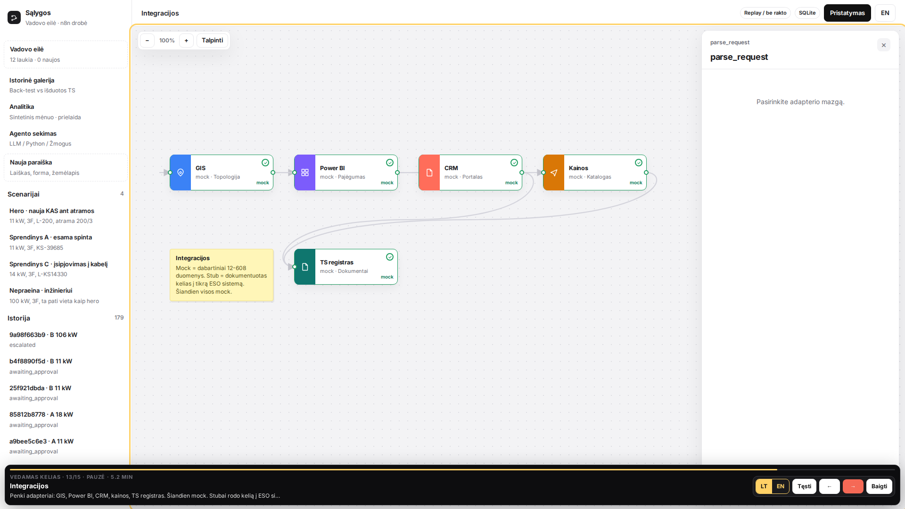 |
| Analitika | 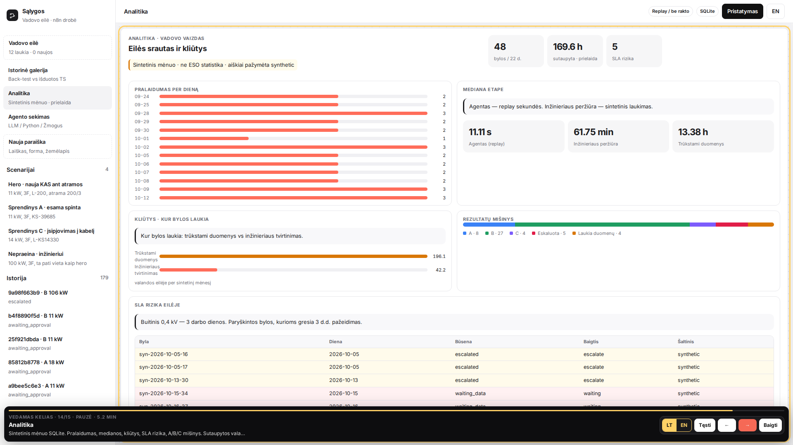 |
| A4 one-pager | 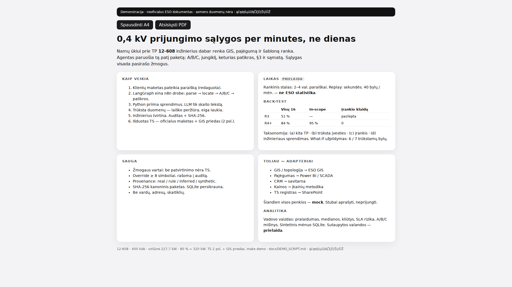 |

Backup demo videos (full guided autoplay, ~5 min 10 s, 1920×1080): artifacts `present_autoplay_lt_1920x1080.mp4` and `present_autoplay_en_1920x1080.mp4`. Copies land in `docs/media/` only when each file is under ~25 MB.

## Pitch in one minute

1. **Pristatymas** — frozen 4–5 min path, LT/EN, autoplay with pause.
2. **Klientų maketas** — submit 11 kW, tracker gauta → išduota, download TS PDF.
3. Split view: request in on the left, TS out on the right, minutes not days.
4. Fail → reinforcement brief. Gallery → 95 % in-scope, 0 tool errors.
5. **Integracijos** — five adapter nodes, all mock, stubs named.

## Back-test

| | Overall (16) | In-scope | Tool errors |
|---|---|---|---|
| Round 3 | 51 % | mixed | hidden |
| Now | **84 %** | **95 %** | **0** |

What-if fill of missing GIS points: **6 / 7** match. History CSV was not tuned.

## Docs

- [docs/ARCHITECTURE.md](docs/ARCHITECTURE.md)
- [docs/NEXT_STEPS.md](docs/NEXT_STEPS.md)
- [docs/DEMO_SCRIPT.md](docs/DEMO_SCRIPT.md)
- [docs/BACKTEST.md](docs/BACKTEST.md)
- [docs/PITCH_FACTS.md](docs/PITCH_FACTS.md)

Customer names, addresses and meter serials are not in the demo.
