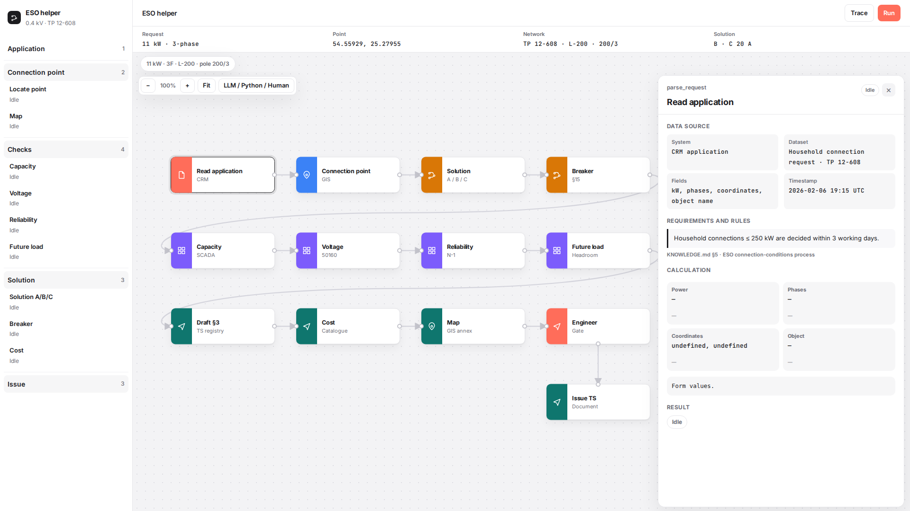
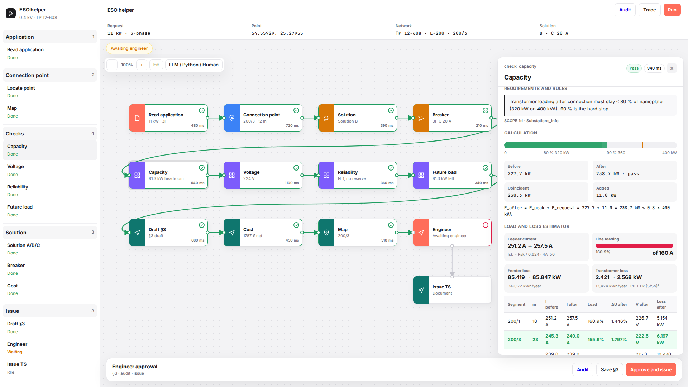
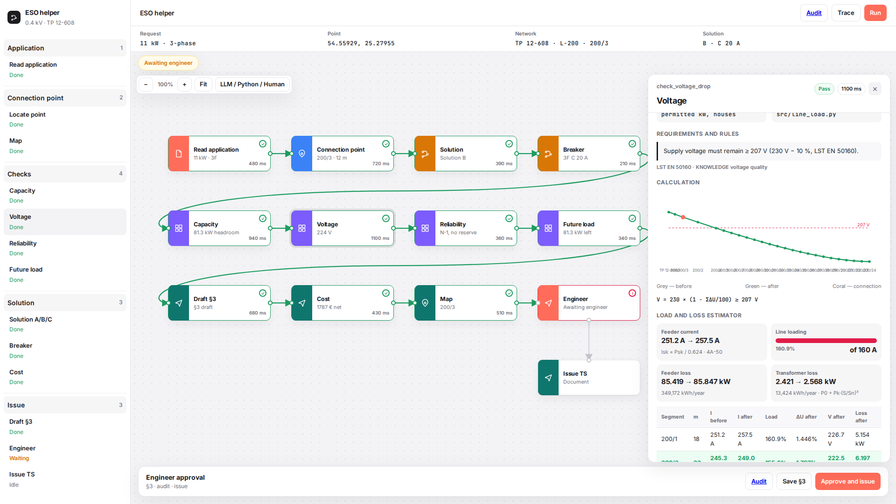
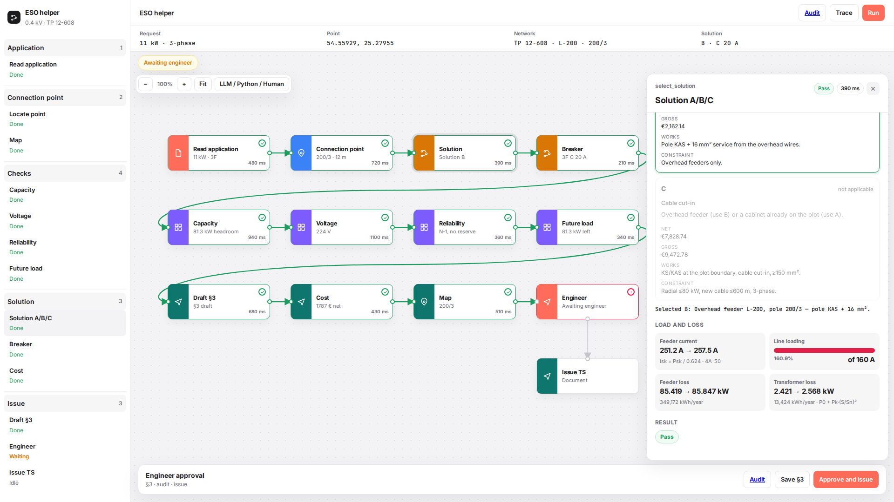
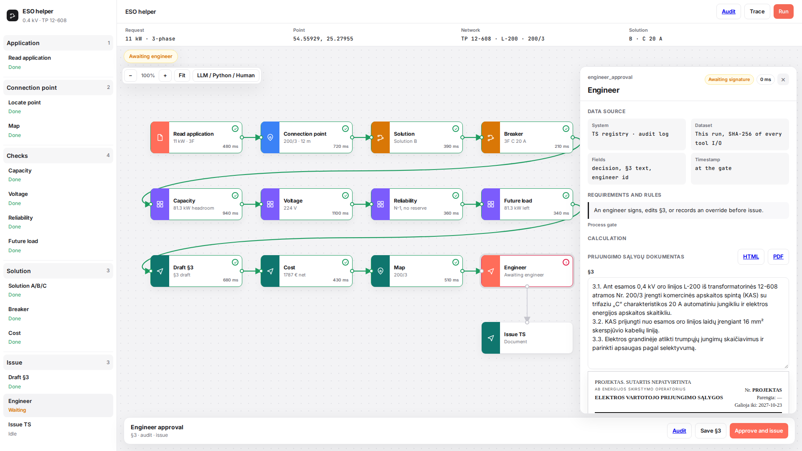
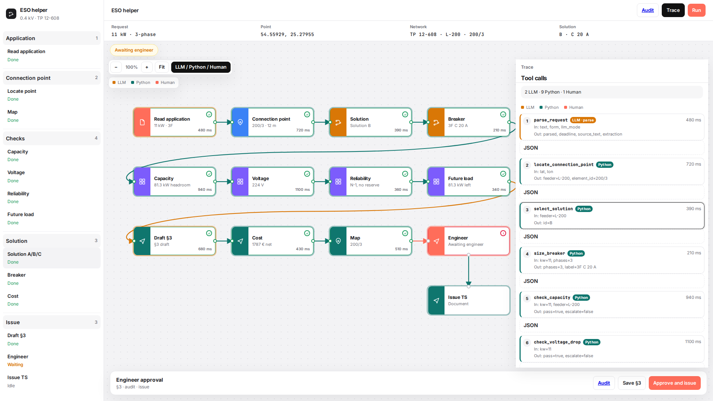

# ESO helper

[](https://github.com/VentureJuozas/ESO-automation/actions/workflows/ci.yml)

**ESO helper** prepares 0.4 kV household connection conditions for one case on substation **TP 12-608**: 11 kW, 3-phase, feeder **L-200**, pole **200/3**, solution **B**, breaker **C 20 A**.

The UI is English. The issued document — *Prijungimo sąlygų dokumentas* — stays Lithuanian (preview and PDF).

Deterministic Python decides. The LLM only reads the request and may phrase §3. An engineer always approves.

## Flow

1. Request (11 kW · 3F · TP 12-608)
2. Agent steps on the node graph
3. Engineer approval and audit
4. Two-page Lithuanian TS + GIS annex

Each step panel shows **data source**, **requirements and rules**, **calculation**, and **result**. Capacity and voltage include a load and loss estimator (`src/line_load.py`): line loading before/after, voltage drop to the customer, feeder and transformer losses (kW and kWh/year).

## Quickstart

Python 3.11+ and Node 20+. No API key.

```bash
make demo
```

Open http://127.0.0.1:8000 — or `bash scripts/demo.sh` / `docker compose up --build`.

```bash
make test
```

`make demo` installs Python deps and **builds `web/dist` if it is missing**, then serves on :8000.

## Screenshots

1920×1080 set under `docs/media/`.

| View | File |
|---|---|
| Full flow |  |
| Sidebar groups |  |
| Capacity + load/loss |  |
| Voltage |  |
| Solution |  |
| Approval |  |
| Trace |  |
| TS page 1 |  |
| TS page 2 — GIS annex |  |

## Hero case

| Item | Value |
|---|---|
| Request | 11 kW, 3-phase, 54.55929, 25.27955 |
| Network | TP 12-608 · L-200 · pole 200/3 |
| Transformer | 400 kVA · peak 227.7 kW · after 238.7 kW ≤ 320 kW (80 %) |
| Voltage | ≥ 207 V (LST EN 50160) |
| Solution | B · new pole KAS + 16 mm² |
| Breaker | C 20 A (§15) |

Provenance of fixtures (real / rule / inferred / synthetic) is documented in [docs/PITCH_FACTS.md](docs/PITCH_FACTS.md), not labelled in the UI.

## Docs

- [docs/ARCHITECTURE.md](docs/ARCHITECTURE.md)
- [docs/NEXT_STEPS.md](docs/NEXT_STEPS.md)
- [docs/DEMO_SCRIPT.md](docs/DEMO_SCRIPT.md)
- [docs/PITCH_FACTS.md](docs/PITCH_FACTS.md)
- [CHANGELOG.md](CHANGELOG.md)
