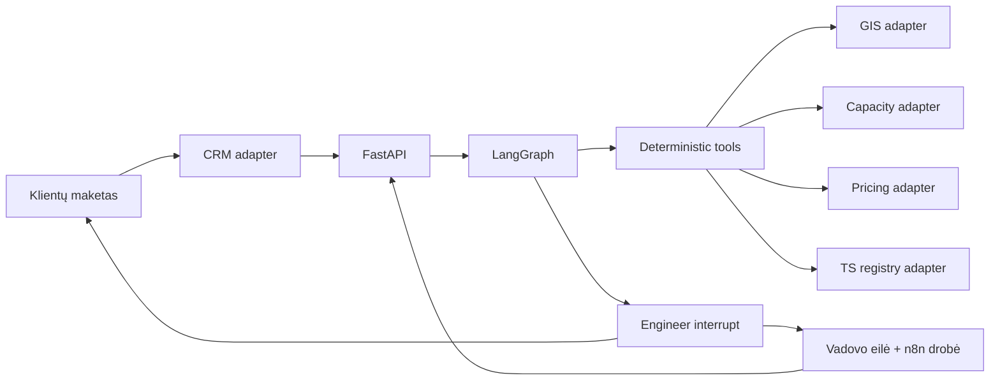
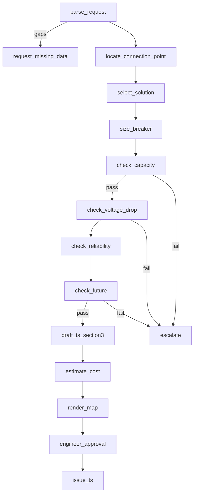

# Architecture

The dashboard is an n8n-style orchestrator over a LangGraph. Deterministic Python makes every engineering decision. The LLM, when a key is present, only parses free text and may rephrase TS §3. An engineer always approves. Queue, runs and audit live in SQLite. A **customer mock** sits beside the manager desk. Five **adapters** hide ESO systems (mock today, stub tomorrow).

## Adapters (production path)

| Adapter | Mock (today) | Real stub |
|---|---|---|
| GIS / topology | Synthetic 12-608 poles and cabinets | ESO GIS + Objects_network_power |
| Power BI / SCADA | Peak 227.7 kW, 80/90 % | Power BI free-capacity + 15 min SCADA |
| CRM / portal | SQLite redacted applications | Official savitarna queue |
| Pricing | 26-E-37934 rates | Tariff methodology / SAP |
| TS registry | SQLite + SHA-256 | SharePoint document store |

`ESO_ADAPTERS=mock` (default). Stubs raise `NotImplementedError` with the target system name. Contract tests keep mock and stub method sets aligned. The **Integracijos** canvas shows each node, mock/stub, what it supplies, and which tool consumes it.

## Customer mock

Household form: object, redacted address, kW, phases, map pick. Tracker: gauta → tikrinama → laukia inžinieriaus → išduota. Missing-data letter is answered on the page and resumes the graph. Issued TS downloads as HTML and a minimal PDF. No ESO logo. Banner: demonstracinis maketas.

## Tool contracts

| Tool | Input | Output | LLM? |
|---|---|---|---|
| parse_request | text + form | kw, phases, coords, missing | optional |
| request_missing_data | gaps | unsent letter, provisional A/B/C | no |
| locate_connection_point | lat, lon | nearest pole/cabinet via GIS adapter | no |
| select_solution | feeder type, distance | A / B / C | no |
| size_breaker | total kW, phases | C n A | no |
| check_capacity | added kW, capacity adapter | 80/90 %, Isk | no |
| check_voltage_drop / reliability / future | added kW | V≥207, N-1, reserve | no |
| draft_ts_section3 | solution + numbers | §3 Lithuanian | optional wording |
| estimate_cost | pricing adapter | net/gross | no |
| render_map / escalate / engineer_approval / issue_ts | — | map, brief, interrupt, registry | no |

## LLM vs Python

Python decides. LLM only parses text and may rephrase §3. Offline if no key.

## Agento sekimas

For a selected run the n8n canvas can show an **LLM / Python / Žmogus** overlay. Nodes and edges are colour-coded by kind. A trace timeline lists each tool call: step, name, kind (LLM parse/phrasing, deterministic Python, or human gate), summarised inputs/outputs with expandable JSON, duration, provenance tags, and the rule / KNOWLEDGE section. Header: `X LLM kvietimai · Y deterministiniai įrankiai · 1 žmogaus vartai`. `/api/runs/{id}/trace` returns the same payload.

## Provenance, approval, queue, back-test

`real` | `rule` | `inferred` | `synthetic`. Interrupt at approval or escalate or waiting_data. Gallery in-scope 95 %, overall 84 %, tool errors 0. What-if fill 6/7.

## Presentation

**Pristatymas**: frozen beats, LT/EN, arrows, per-beat autoplay (~5 min, under 5:15) with pause. Split beat shows customer mock + desk. **Agento sekimas** beat turns on the kind overlay. Integracijos / Analitika follow. A4 leave-behind at `/api/onepager.html`.
