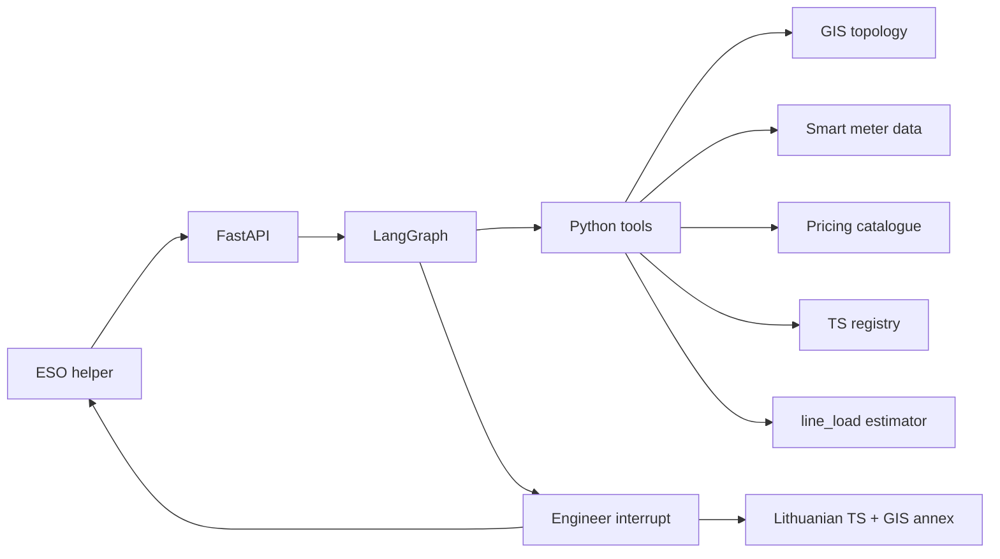
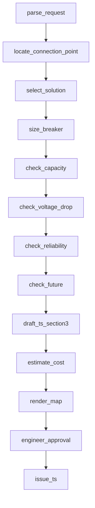

# Architecture

**ESO helper** is a LangGraph orchestrator behind a FastAPI service and an English node-graph dashboard. Deterministic Python makes every engineering decision. The LLM, when a key is present, only parses free text and may rephrase TS §3. An engineer always approves. The only Lithuanian surface is the issued two-page *Prijungimo sąlygos* document.

One case is in scope: 11 kW, 3-phase, TP 12-608, L-200, pole 200/3, solution B.

## Step panels

Every opened step uses the same structure:

| Block | Content |
|---|---|
| Data source | System, dataset, fields, timestamp (GIS, smart meter data, CRM, pricing, TS registry) |
| Requirements and rules | Quoted clause + KNOWLEDGE / SCOPE / standard reference |
| Calculation | Numbers, formula, gauges, map, A/B/C, breaker table, cost table, load/loss |
| Result | Pass or fail |

Capacity and voltage attach `estimate_load_loss()` from `src/eso_agent/load_loss.py`:

- feeder current `I = P_feeder / 0.624` using L-200 `meter_max_kw` (not the TP peak)
- voltage `ΔU = L_km × Psk × kU` with `Psk = ΣP_perm × k(n)` on the TP → customer span
- feeder loss `3 × I² × R` with `R = r_Ω/km × L_km` on that same span
- transformer loss `P0 + Pk × (S/Sn)²` on 400 kVA (P0 0.93 kW, Pk 4.60 kW)
- energy `P_peak × 8760 × (0.3 LF + 0.7 LF²)`
- line loading fails the flow when any segment is above 100 % of ampacity

The solution step shows a compact before/after summary of the same estimate.

## Tool contracts

| Tool | Input | Output | LLM? |
|---|---|---|---|
| parse_request | text + form | kW, phases, coords | optional |
| locate_connection_point | lat, lon | nearest pole/cabinet | no |
| select_solution | feeder type, distance | A / B / C | no |
| size_breaker | total kW, phases | C n A | no |
| check_capacity | added kW + load | 80/90 %, load/loss | no |
| check_voltage_drop | added kW + feeder | V ≥ 207, profile, load/loss | no |
| check_reliability / future | location, solution | N-1, headroom | no |
| draft_ts_section3 | solution + numbers | Lithuanian §3 | optional wording |
| estimate_cost / render_map | pricing / GIS | net/gross, annex | no |
| engineer_approval / issue_ts | decision | audit, 2-page TS | no |

## LLM vs Python vs human

Python decides. LLM only parses text and may rephrase §3. Offline if no key. The trace overlay colour-codes LLM (amber), Python (teal) and Human (coral). `/api/runs/{id}/trace` returns the same payload.

## Data and persistence

Adapters (GIS, capacity, CRM, pricing, registry) still sit behind the tools. Their contracts and fixture tags live in the docs, not in the dashboard. Runs and the SHA-256 audit persist in SQLite.

## Out of the product UI

Scenario pickers, the 12-case queue, history gallery, customer split view, presentation autoplay, what-if, and time-saved HUD are not part of the dashboard. Backend endpoints for those experiments may still exist; they are not the product.
