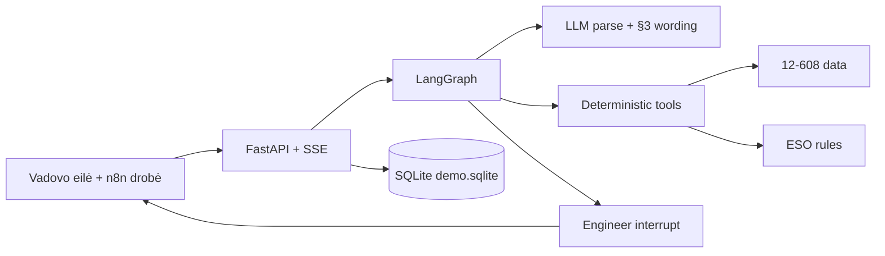
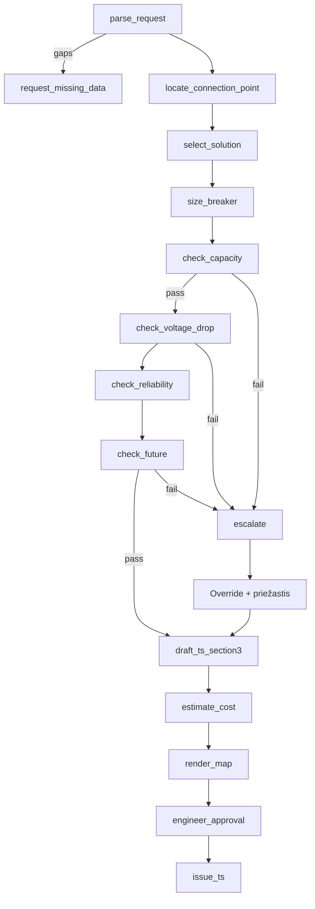

# Architecture

The dashboard is an n8n-style orchestrator over a LangGraph. Deterministic Python makes every engineering decision. The LLM, when a key is present, only parses free text and may rephrase TS §3. An engineer always approves. Queue, runs and audit live in SQLite so a restart keeps the desk. **Pristatymas** plays a frozen 4–5 minute jury path (LT/EN). A what-if bar recomputes A/B/C and the four checks live. Missing inputs branch to `request_missing_data` instead of silently using the hero point.

## Layers

| Layer | Role |
|---|---|
| Manager desk | Today's queue, SLA, Paleisti visas, HUD, engineer inbox |
| n8n canvas | One run: node cards, live edges, overlay inspector |
| Gallery | Honest back-test vs issued 12-608 TS + two reference cases |
| FastAPI | REST, SSE, printable TS / brief / audit HTML |
| LangGraph | Ordered nodes, interrupt at approval or escalate |
| Tools | Breaker, locate, A/B/C, four checks, cost, map, brief |
| SQLite | Queue rows, run snapshots, engineer audit actions |
| Human | Approve, edit §3, override with a reason |

## Tool contracts

| Tool | Input | Output | LLM? |
|---|---|---|---|
| parse_request | text + form | kw, phases, coords, existing_kw, deadline, missing | optional |
| request_missing_data | parser gaps / missing GIS | letter preview (not sent), provisional A/B/C, sensitivity | no |
| locate_connection_point | lat, lon | nearest pole/cabinet, feeder | no |
| select_solution | feeder type, distance | A / B / C | no |
| size_breaker | **total** permitted kW, phases | C n A from KNOWLEDGE §15 | no |
| check_capacity | **added** kW (total − existing), feeder, peak | 80/90 % TR, Isk vs fuse | no |
| check_voltage_drop | added kW, conductor, baseline | V after ≥ 207 | no |
| check_reliability | feeder, solution | N-1 note, cut-in count | no |
| check_future | pending_kw, headroom | reserve | no |
| draft_ts_section3 | solution + numbers | §3 Lithuanian | optional wording |
| estimate_cost | solution, length | net/gross, 11.78 % labour, 21 % VAT | no |
| render_map | location | Leaflet payload | no |
| escalate | failed check | reinforcement brief | no |
| engineer_approval | draft | interrupt | human |
| issue_ts | approval | redacted A4 document | no |

Capacity adds only the increment. Existing load is already in the 227.7 kW peak. A synthetic fuse does not block. A single below-207 V event is filtered.

## LLM vs Python

- **Python** sizes the breaker, locates the point, chooses A/B/C, runs the four checks, costs, map, brief.
- **LLM** (if `OPENAI_API_KEY`) parses free text and may rephrase §3. Numbers stay from tools.
- **Offline / replay** if no key: regex parse + templates. The stage demo never blocks on a key or a tile server.

## Provenance tags

`real` | `rule` | `inferred` | `synthetic` on every number. Raw CSVs with customer locations stay git-ignored.

## Approval interrupt

The graph stops at `engineer_approval` or `escalate`. Approve issues the TS. Edit rewrites §3 and stays at the gate. Override requires ≥ 8 characters, is written to the audit, then the post-check tools run. There is no “issue anyway” without a reason.

## Queue

Twelve redacted 12-608 cases (A/B/C, fail, missing data). SLA = 3 working days (KNOWLEDGE §5). Paleisti visas runs the graph sequentially. Inbox is the human gate. **Atstatyti demo** clears SQLite and reseeds.

## Back-test and audit

Gallery replays issued TS. In-scope accuracy is reported separately from the 16-case overall score. Each mismatch has a category: (a) out of scope, (b) missing input, (c) tool error, (d) engineer judgment. Audit export is JSON + HTML with SHA-256 of the canonical payload.

## Hero path

11 kW, 3F, `54.55929, 25.27955` → L-200 / 200/3 → B → 20 A → four checks pass → draft → cost → map → approve → one-year TS.
