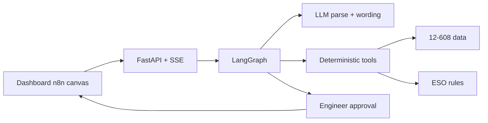
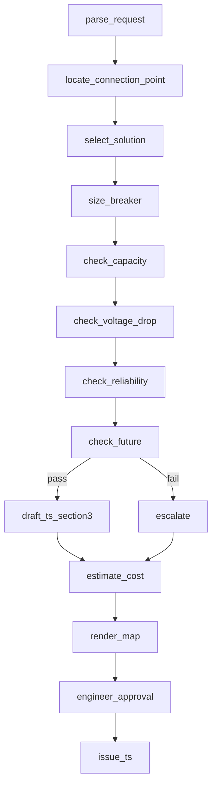

# Architecture

The dashboard is an n8n-style orchestrator. A LangGraph graph walks a fixed pipeline of deterministic Python tools. Two nodes may call an LLM (request parse, TS §3 wording). Every engineering decision is code. The engineer always approves before issue.

## Layers

| Layer | Role |
|---|---|
| Dashboard | Lithuanian n8n canvas: node cards, animated edges, right inspector |
| FastAPI | REST + SSE tool-call events, printable TS HTML |
| LangGraph | Ordered nodes, interrupt at approval |
| Tools | Breaker, locate, A/B/C, four checks, cost, map |
| Data | Substation 12-608 summaries (real) + tagged synthetic fixtures |
| Human | Approve, edit §3, rerun a node |

## LLM vs Python

- **Python** sizes the breaker, locates the point, chooses A/B/C, runs capacity / voltage / reliability / future, costs, map.
- **LLM** (if `OPENAI_API_KEY` is set) parses free text and may rephrase §3. Numbers stay from tools.
- **Offline / replay** if no key: regex parse + Lithuanian templates. The live demo never blocks on an API key.

## Data tags

Every number is tagged `real` | `rule` | `inferred` | `synthetic`. Raw CSVs with customer locations and meter serials are git-ignored. The map shows poles and cabinets only.

## Hero path

New household, 11 kW, 3F, `54.55929, 25.27955` → TP 12-608, overhead `L-200`, pole `200/3`, solution B (new KAS). No empty inputs: missing fuse, conductor and lengths are filled with tagged defaults and the line-load calculator. Engineer approval issues a one-year TS.

## Manual time

The value strip compares agent seconds to an **assumed** 2–4 hour engineer baseline. That is not ESO statistics.
